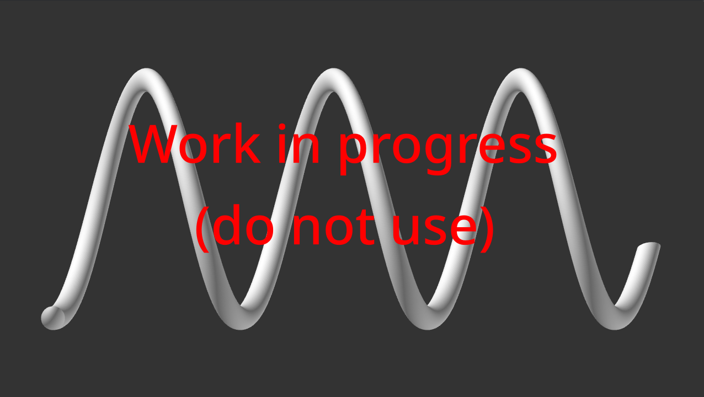
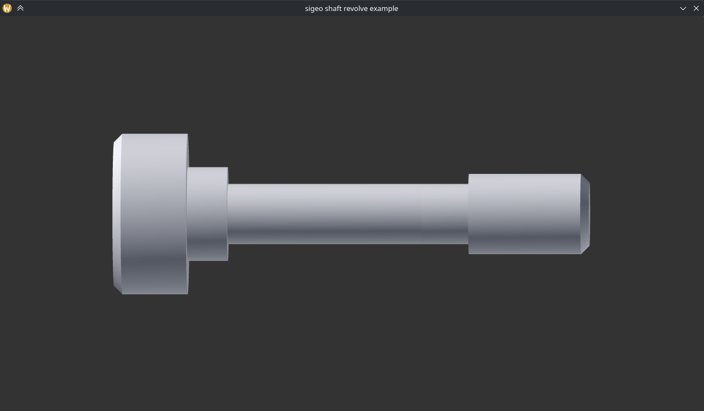

# sigeo

Computational geometry



(work-in-progress, do not use)


## Example

[extrusion, shown on window](examples/extrusion.nim)

```nim
proc spiralF(t: float): Point3 = point3(cos(t / 50) * 2, t / 100, sin(t / 50) * 2)

let spiral = Curve3d(
  speedAtParam: proc(t: FloatParam): Float =
    1 / 20
  ,
  pointAtParam: proc(t: FloatParam): Point3 =
    spiralF(t * 1000)
  ,
  derAtParam: proc(t: FloatParam): NormalVec3 =
    let u = t * 20
    vec3(-sin(u) * 40, 10, cos(u) * 40).normal
  ,
  xAxisAtParam: proc(t: FloatParam): NormalVec3 =
    let u = t * 20
    vec3(cos(u), 0, sin(u)).normal
  ,
)

let circle = circleArc(point2(), 1/2)


let grid = extrusionShellGrid(
  contour = circle,
  spine = spiral,
  # sag = 0.1,
)
```


[shaft, shown on window](examples/shaft.nim)


## SDF

`sigeo/sdf` provides a signed distance field (SDF) core based on
[Inigo Quilez's article "Distance functions"](https://iquilezles.org/articles/distfunctions/):
primitives (`sdSphere`, `sdBox`, `sdTorus`, `sdCappedCone`, ...), operators
(`opUnion`, `opSmoothUnion`, `opSubtraction`, `opElongate`, `opRound`, `opOnion`,
`opTwist`, `opRepetition`, ...), and a translation of an SDF world into polygons
(`polygonize`, marching tetrahedra producing a watertight `Grid3`).

```nim
import sigeo/[core, sdf]

let shape = sdSphere(p3(0, 0, 0), 1)
  .opUnion(sdBox(p3(1.5, 0, 0), v3(1, 0.5, 0.5)))
  .opSmoothUnion(sdSphere(p3(1.5, 1.5, 0), 0.6), 0.3)
  .opRound(0.05)

let mesh: Grid3 = shape.polygonize(step = 0.05)
```

Every `Sdf3` tracks conservative bounds, so `polygonize` can detect the sampling
area automatically; unbounded shapes (planes, infinite repetition, space
deformations like `opTwist`) require explicit bounds:

```nim
let twisted = sdBox(p3(0, 1, 0), v3(0.85, 0.3, 0.3)).opTwist(2.2)
let mesh = twisted.polygonize(bounds3(p3(-1.6, 0, -1.6), p3(1.6, 2, 1.6)), step = 0.025)
```

2D SDFs (`Sdf2`) can be extruded and revolved into 3D: `sdCircle(...).opExtrusion(0.5)`,
`sdCircle(...).opRevolution(1.0)`.

There is also a full set of exact 2D primitives from Inigo Quilez's article
["2D distance functions"](https://iquilezles.org/articles/distfunctions2d/):
`sdRoundedBox`, `sdChamferBox`, `sdOrientedBox`, `sdRhombus`, `sdTrapezoid`,
`sdParallelogram`, `sdTriangle`/`sdTriangleIsosceles`/`sdEquilateralTriangle`,
`sdUnevenCapsule`, `sdPentagon`/`sdHexagon`/`sdOctogon`, `sdHexagram`/`sdPentagram`/`sdStar`,
`sdPie`, `sdCutDisk`, `sdArc`, `sdRing`, `sdHorseshoe`, `sdVesica`/`sdOrientedVesica`,
`sdMoon`, `sdRoundedCross`, `sdCross`, `sdRoundedX`, `sdEgg`, `sdHeart`, `sdEllipse`,
plus sketches made of polylines: `sdPolygon` (a signed closed contour) and
`sdPolyline` (an unsigned wire). The 2D operators (`opUnion`, `opSmoothUnion`,
`opSubtraction`, `opRound`, `opOnion`, `opTranslate`, `opRotate`, `opSymX`, ...)
mirror the 3D ones, so a typical 2D-to-3D workflow looks like:

```nim
let sketch = sdPolygon([p2(-1, -1), p2(1, -1), p2(1, 1), p2(-1, 1)])
  .opSubtraction(sdCircle(p2(0, 0), 0.5))
let plate = sketch.opExtrusion(0.5)
let mesh: Grid3 = plate.polygonize(step = 0.05)
```


## Compile flags

- Float size:  
  Which float type to use by default in sigeo, also applied as float type for vectors, points and matrices.
  - `-d:sigeo_use_float64` (default) - Float = float64
  - `-d:sigeo_use_float32` - Float = float32

- Zero-sized vector normalization:  
  What to do if trying to normalize zero-sized normal vector.
  - `-d:sigeo_raise_valueError_when_zeroLen_normal_vector` (default) - raise an error
  - `-d:sigeo_assume_no_zeroLen_normal_vector` - undefined behaviour
  - `-d:sigeo_return_axisX_when_zeroLen_normal_vector` - return vec2(1, 0) | vec3(1, 0, 0)

- Zero-sized curves:  
  What to do if trying to create zero-sized curve.
  - `-d:sigeo_raise_exception_when_costructed_curve_has_zero_length` (default) - raise exception
  - `-d:sigeo_return_small_curve_when_costructed_curve_has_zero_length` - create a very small curve

